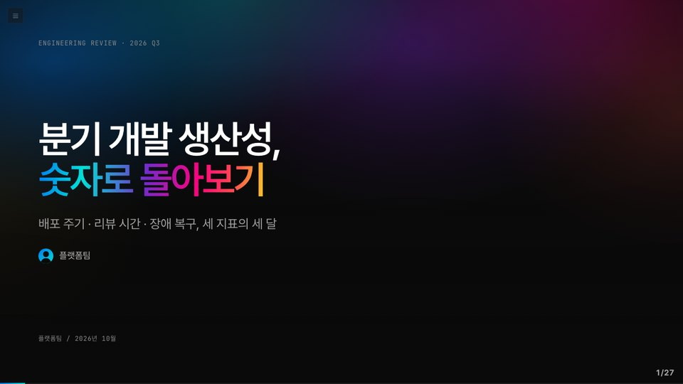

# Slidev Themes · jussam · hossam

[](https://sli.dev)

[](https://github.com/leekh4232/slidev-themes/commits/main)
[](https://marketplace.visualstudio.com/items?itemName=leekh.open-with-slidev)
[](LICENSE)

🌐 **소개 페이지 · [slidev-themes.hossam.kr](https://slidev-themes.hossam.kr/)**

[Slidev](https://sli.dev) 발표용 테마 두 개를 담은 저장소입니다. VS Code 확장 [Open with Slidev](https://marketplace.visualstudio.com/items?itemName=leekh.open-with-slidev)가 이 저장소에서 테마를 내려받아 씁니다.

| 테마 | 성격 | 매뉴얼 |
|:--|:--|:--|
| [`jussam`](jussam/) | 특강 · 발표용 다크 테마. 검정 바탕, 메시 그라디언트 표지, 파트별 시그니처 색, 카드 · 스탯 · 차트 컴포넌트 22종 | [jussam 사용법](https://slidev-themes.hossam.kr/jussam.html) |
| [`hossam`](hossam/) | 코딩 기초 강의용 라이트 테마. 왼쪽 목차 사이드바(폭 조절 · 접기 · 본문 폭 · 확대/축소 · 다크), 콜아웃 · 프롬프트 · 출력 상자 | [hossam 사용법](https://slidev-themes.hossam.kr/hossam.html) |



## Open with Slidev에서 쓰기

슬라이드 md 파일의 프런트매터에 테마 이름만 적으면 됩니다.

```md
---
theme: jussam        # 또는 hossam
title: 발표 제목
---
```

확장이 처음 쓸 때 이 저장소의 `main` 브랜치를 내려받아 캐시에 두고, 이후에는 VS Code를 다시 켤 때마다 새 커밋이 있는지 확인해 갱신합니다. 이 저장소에 push하면 확장을 다시 배포하지 않아도 테마가 바뀝니다.

## Slidev에서 직접 쓰기

Slidev 프로젝트에 테마 폴더를 복사한 뒤 경로로 지정합니다.

```sh
git clone https://github.com/leekh4232/slidev-themes.git
npx slidev slides.md --theme ./slidev-themes/jussam
```

프런트매터에 `theme: ./slidev-themes/jussam`처럼 경로를 적어도 됩니다.

## 예제 덱

- [docs/examples/jussam-example.md](docs/examples/jussam-example.md): 분기 개발 생산성 리뷰(가상 수치). 레이아웃 3종과 컴포넌트 전부를 한 번씩 씁니다.
- [docs/examples/hossam-example.md](docs/examples/hossam-example.md): 파이썬 기초 3강. 콜아웃 · 프롬프트 · 출력 · 단계 목록과 사이드바.

## 폴더 구조

```
jussam/   layouts/ · components/ · styles/ · global-top.vue · package.json
hossam/   components/ · setup/ · styles/ · global-top.vue · package.json
docs/     소개 페이지 · 매뉴얼(jussam.html · hossam.html) · 화면(img/) · 예제 덱(examples/)
```

테마마다 `package.json`의 `slidev.defaults`에 화면 비율 · 캔버스 폭 · 글꼴 기본값이 있습니다. 컴포넌트의 프롭은 각 `.vue` 파일 머리 주석과 매뉴얼에 있습니다.

## 라이선스

MIT
