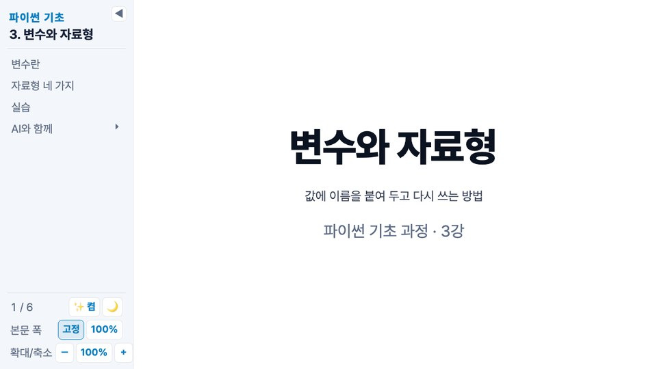

# Slidev Themes · hossam · jussam

[](https://sli.dev)


[](https://github.com/leekh4232/slidev-themes/commits/main)
[](https://marketplace.visualstudio.com/items?itemName=leekh.open-with-slidev)
[](LICENSE)

🌐 **소개 페이지 · [slidev-themes.hossam.kr](https://slidev-themes.hossam.kr/)**

[Slidev](https://sli.dev) 테마 `hossam` · `jussam`을 담은 저장소입니다. 두 테마는 서로 의존하지 않는 독립 폴더입니다. 저장소를 받아 테마 폴더를 경로로 지정해 씁니다. VS Code에서는 [Open with Slidev](https://marketplace.visualstudio.com/items?itemName=leekh.open-with-slidev)로 바로 열 수 있습니다.

`hossam`은 코딩 강의용 테마입니다. 처음 열면 어두운 바탕이고 d 키(🌙/☀️ 버튼)로 밝게 바꿉니다. 상자는 모두 직각(1px 가는 선 · 4px 윗선, 그림자 없음)입니다. 목차 사이드바(폭 조절 · 접기 · 확대/축소 · 다크), 표지 · 간지 · 카드형 · 웹진형 · 인포그래픽 레이아웃, 상자(Callout: 콜아웃 · 프롬프트 · 출력 · 번호 머리띠를 `kind`와 프롭으로 조정) · 타일(Tile: 라벨 · 제목 · 큰 숫자 · 본문을 쌓는 직각 상자, `kind`로 바탕 조정) · 핵심 한 줄(Core) · 칩(Chip) · 번호 목록(Steps: 단계 · 흐름도 · 타임라인을 `type`으로 조정) · 격자 · 큰 숫자 · 유튜브 썸네일 컴포넌트와 형광펜(`.hl`) · 빈칸(`.blank`) 클래스가 있고, 모든 슬라이드 오른쪽 아래에 쪽 번호(현재/전체)가 붙고, 덱 헤더(첫 슬라이드 프런트매터)의 `sidebar`로 사이드바를 켜고 끕니다(켜도 처음에는 접힌 채 열리고 ☰ 버튼 · s 키로 펼칩니다). 슬라이드는 항상 16:9 비율로 창에 맞춰 확대·축소되고, 넘치는 내용은 스크롤 없이 잘리며 빨간 테두리로 표시됩니다. 자세한 내용은 [hossam 사용법](https://slidev-themes.hossam.kr/hossam.html)에 있습니다.



`jussam`은 특강·발표용 테마입니다. 처음 열면 검정 바탕이고 d 키로 밝게 바꿉니다. 메시 그라디언트 표지 · 파트별 시그니처 색(`part: 1~4`) · 둥근 카드(12px)와 그림자가 특징이고, 카드(Card) · 큰 숫자(Stat `n`) · 히어로(Hero) · 목차(Agenda · NumList · Item) · 전후 비교(BeforeAfter · Side) · 맺음말(Kicker) · 차트(Gauge · Slope · Meter · HBar · Bars · Funnel · Branch · Mul · Formula · 날짜 축 Timeline `events`) 컴포넌트가 있습니다. 목차 사이드바 · 원고 보기 · 확대/축소 · 넘침 표시 · 쪽 번호, 카드형 · 웹진형 · 인포그래픽 레이아웃, Callout · Prompt · Output · Steps · Tile · Core · Chip 같은 기본 컴포넌트는 hossam과 같은 방식으로 들어 있습니다. 자세한 내용은 [jussam 사용법](https://slidev-themes.hossam.kr/jussam.html)에 있습니다.


## 쓰는 법

이 저장소를 받은 뒤, 슬라이드 md 파일의 프런트매터에 테마 폴더 경로를 적습니다. 경로는 md 파일이 있는 폴더 기준입니다.

```sh
git clone https://github.com/leekh4232/slidev-themes.git
```

```md
---
theme: ./slidev-themes/hossam   # 발표용은 ./slidev-themes/jussam
sidebar: true        # 생략하면 켬. 처음엔 접힌 채 열리고 s 키로 펼침
exportDark: true     # 생략하면 켬. PDF·PNG 내보내기를 어두운 테마로
colorMode: dark      # 생략 가능. light | dark, 덱을 열 때의 테마(d 키로 바꿀 수 있음)
fontScale: 1        # 생략 가능. 0.6~2, 덱을 열 때의 본문 배율
manuscript: true     # 생략하면 켬(false 면 끔). 사이드바에 📄 원고 버튼(덱 원고 md를 깃헙 스타일 문서로 보기)
title: 과정 이름 · 단원 이름
author: 홍길동 강사    # 생략 가능. 표지 부제 아래 작성자
---
```

VS Code에서는 md 파일을 우클릭 → **Open with Slidev**로 열고, 터미널에서는 `npx slidev slides.md`로 엽니다. 테마 폴더를 고치면 다시 열 때 그대로 반영됩니다. 새 버전은 `git pull`로 받습니다.

## 예제 덱

- [docs/examples/jussam-example.md](docs/examples/jussam-example.md): jussam · 분기 개발 생산성 리뷰(가상의 수치). 표지 · 파트 간지 · 발표 컴포넌트 전부와 기본 컴포넌트, 카드형 · 웹진형 레이아웃.
- [docs/examples/lecture-example.md](docs/examples/lecture-example.md): hossam · 파이썬 기초 3강. 간지 · 카드형 · 웹진형 · 인포그래픽 레이아웃, 콜아웃 · 프롬프트 · 출력 · 번호 머리띠 · 타일 · 핵심 한 줄 · 칩 · 형광펜 · 빈칸 · 단계 목록 · 흐름도 · 타임라인 · 큰 숫자 타일과 사이드바.

## 폴더 구조

```
hossam/   layouts/(cover · section · default · cards · magazine · infographic) · components/ · setup/ · styles/(lecture.css · shared.css) · deck.ts · global-top.vue · package.json
jussam/   layouts/(cover · section · default · cards · magazine · infographic) · components/ · setup/ · styles/(jussam.css · shared.css) · deck.ts · global-top.vue · package.json
docs/     소개 페이지 · 매뉴얼(hossam.html · jussam.html) · 화면(img/) · 예제 덱(examples/)
```

각 테마의 `package.json` `slidev.defaults`에 화면 비율 · 캔버스 폭 · 글꼴 기본값이 있습니다. 컴포넌트의 프롭은 각 `.vue` 파일 머리 주석과 매뉴얼에 있습니다.

## 라이선스

MIT
