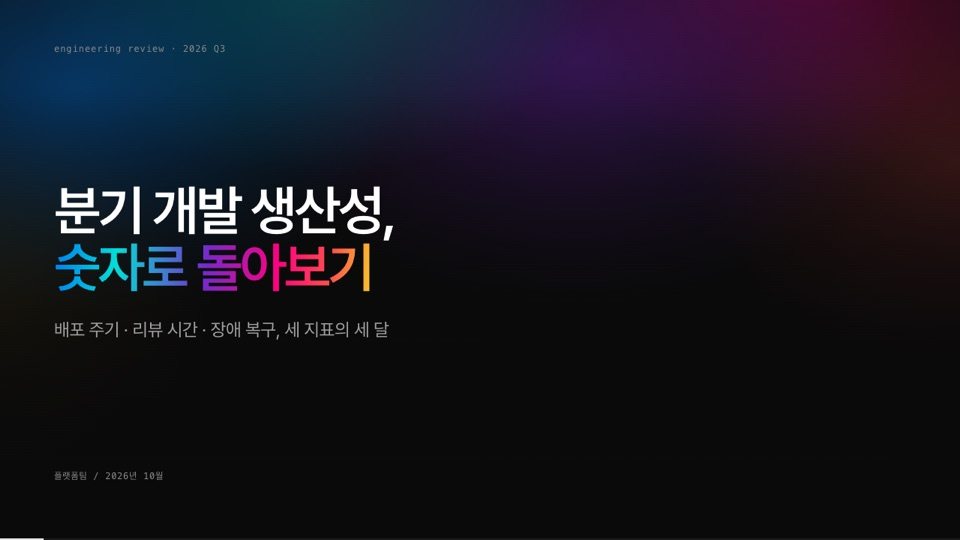

# Slidev Themes · hossam

[](https://sli.dev)

[](https://github.com/leekh4232/slidev-themes/commits/main)
[](https://marketplace.visualstudio.com/items?itemName=leekh.open-with-slidev)
[](LICENSE)

🌐 **소개 페이지 · [slidev-themes.hossam.kr](https://slidev-themes.hossam.kr/)**

[Slidev](https://sli.dev) 테마 `hossam`을 담은 저장소입니다. 저장소를 받아 테마 폴더를 경로로 지정해 씁니다. VS Code에서는 [Open with Slidev](https://marketplace.visualstudio.com/items?itemName=leekh.open-with-slidev)로 바로 열 수 있습니다.

덱 헤더(첫 슬라이드 프런트매터)의 `style`로 두 모양 중 하나를 고르고, `sidebar`로 왼쪽 목차 사이드바를 켜고 끕니다. 컴포넌트는 두 스타일 어디서나 씁니다.

| style | 성격 | 사이드바 기본 | 매뉴얼 |
|:--|:--|:--|:--|
| `lecture` (기본) | 코딩 강의용 흰 바탕. 목차 사이드바(폭 조절 · 접기 · 본문 폭 · 확대/축소 · 다크), 콜아웃 · 프롬프트 · 출력 상자 | 켬 | [hossam 사용법](https://slidev-themes.hossam.kr/hossam.html) |
| `talk` | 특강 · 발표용 검정 바탕. 메시 그라디언트 표지, 파트별 시그니처 색, 카드 · 스탯 · 차트 컴포넌트 | 끔 | [talk 스타일](https://slidev-themes.hossam.kr/talk.html) |



## 쓰는 법

이 저장소를 받은 뒤, 슬라이드 md 파일의 프런트매터에 테마 폴더 경로를 적습니다. 경로는 md 파일이 있는 폴더 기준입니다.

```sh
git clone https://github.com/leekh4232/slidev-themes.git
```

```md
---
theme: ./slidev-themes/hossam
style: talk          # 생략하면 lecture
sidebar: true        # 생략하면 lecture는 켬, talk는 끔
title: 발표 제목
---
```

VS Code에서는 md 파일을 우클릭 → **Open with Slidev**로 열고, 터미널에서는 `npx slidev slides.md`로 엽니다. 테마 폴더를 고치면 다시 열 때 그대로 반영됩니다. 새 버전은 `git pull`로 받습니다.

## 예제 덱

- [docs/examples/lecture-example.md](docs/examples/lecture-example.md): lecture 스타일. 파이썬 기초 3강. 콜아웃 · 프롬프트 · 출력 · 단계 목록과 사이드바.
- [docs/examples/talk-example.md](docs/examples/talk-example.md): talk 스타일. 분기 개발 생산성 리뷰(가상 수치). 레이아웃 3종과 컴포넌트 전부를 한 번씩 씁니다.

## 폴더 구조

```
hossam/   layouts/ · components/ · setup/ · styles/(lecture.css · talk.css · shared.css) · deck.ts · global-top.vue · package.json
docs/     소개 페이지 · 매뉴얼(hossam.html · talk.html) · 화면(img/) · 예제 덱(examples/)
```

`hossam/package.json`의 `slidev.defaults`에 화면 비율 · 캔버스 폭 · 글꼴 기본값이 있습니다. 컴포넌트의 프롭은 각 `.vue` 파일 머리 주석과 매뉴얼에 있습니다.

## 라이선스

MIT
