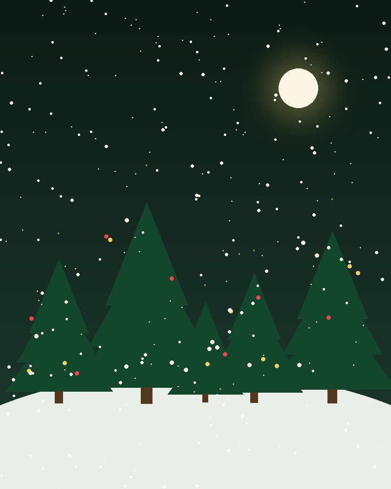

<!--
noel 테마 예제 덱 (가상의 여행 계획). title 의 " · " 앞은 사이드바 위 머리말, 뒤는 단원 이름이 된다.
레이아웃: cover(eyebrow · footer · mesh · source · author) · section(part · eyebrow) · default(eyebrow · part · source) · cards(cols) · magazine(::right::) · infographic
발표 컴포넌트: Hero · Spacer · Agenda/NumList/Item · Timeline(events) · Gauge · Slope · Card(k · t · acc · sm · lg · dim) · Stat(n · fill · mark · scale · sm) · Kicker(lead · muted) · Funnel · Branch · BeforeAfter/Side · HBar · Bars · Note
기본 컴포넌트: Callout · Prompt · Output · Flow · Timeline(li) · Grid · Stat(value) · Tile · Core · Chip
헤더 옵션: sidebar · exportDark · colorMode · fontScale · manuscript
-->

# 바다 앞에서 맞는<br>**한 해의 마지막 밤**

강릉 연말 2박 3일, 가족 여섯 명의 여행 계획

---
layout: cover
mesh: soft
eyebrow: hook
source: 여행 준비팀 계획표 (가상의 수치)
---

<Hero n="62" unit="시간" caption="12/29 14:00 → 12/31 자정 카운트다운">

## 함께 보내는 시간, 62시간

올해는 각자 보내던 연말을 한곳에 모은다<br>이 덱은 그 62시간을 어떻게 쓸지 정리한 계획이다

</Hero>

<Spacer />

### 무엇을 준비했나

---
eyebrow: agenda
---

# 오늘의 순서

<Agenda>
<Item part="1" title="준비 과정">예약 일정과 준비 상황</Item>
<Item part="2" title="동선과 일정">사흘 동안의 이동과 할 일</Item>
<Item part="3" title="예산">어디에 얼마를 쓰는가</Item>
<Item part="4" title="마지막 밤">카운트다운과 새해 첫 해돋이</Item>
</Agenda>

---
layout: section
part: 1
---

# 준비 과정

석 달 전부터 하나씩 채워 온 것들

---
part: 1
eyebrow: timeline
source: 예약 확인 메일
timeline:
  start: 2026-10-01
  end: 2027-01-01
  events:
    - date: 2026.10.12
      name: 숙소 예약
      org: 경포 해변 펜션
      desc: 바다 쪽 방 두 개<br>환불 가능 요금
    - date: 2026.11.08
      name: KTX 예매
      org: 서울역 → 강릉역
      desc: 여섯 자리 같은 칸
    - date: 2026.12.29
      name: 출발
      org: 12/29 오후 2시
      desc: 2박 3일<br>12/31 자정 카운트다운
      hl: true
---

# 석 달 동안 **준비한 세 가지**

<Timeline v-bind="$frontmatter.timeline" />

<Kicker style="margin-top:8px">마지막 점이 이번 여행의 출발일</Kicker>

---
part: 1
eyebrow: ready check
source: 준비 체크리스트
---

# 준비는 **얼마나 됐나**

출발 2주 전 기준, 세 가지 모두 목표선을 넘었다

<Grid cols="3">
<Stat n="18" unit="개" label="체크리스트 완료" :fill="82" :mark="70" scale="22개">눈금은 2주 전 목표 지점</Stat>
<Stat n="6" unit="명" label="참석 확정" :fill="100" scale="6명">전원 확정</Stat>
<Stat n="85" unit="%" label="예약 결제" :fill="85" scale="100%">남은 것은 저녁 한 끼</Stat>
</Grid>

<Kicker lead>남은 네 개는 짐 싸기와 마지막 날 저녁 예약이다</Kicker>

---
part: 1
eyebrow: weather
source: 강릉 12월 평년 기온
---

# 날씨는 **생각보다 따뜻하다**

<Grid cols="330px 1fr">
<Gauge :value="80" label="맑은 날 비율" note="12월 말 강릉 평년 기준" />
<Slope k="daytime high" t="낮 최고 기온" :from="['서울', 2]" :to="['강릉', 6]" :max="10" unit="℃" />
</Grid>

<Grid cols="3">
<Card sm>

해돋이 시각 **07:39**<br>경포 해변 기준

</Card>
<Card sm>

바닷바람 **초속 5m**<br>체감 기온은 영하

</Card>
<Card sm>

일몰 **17:18**<br>저녁 산책은 그 전에

</Card>
</Grid>

---
layout: section
part: 2
---

# 동선과 일정

사흘을 어떻게 나눠 쓸까

---
part: 2
eyebrow: three days
source: 여행 준비팀 계획표
---

# 사흘, **하루 한 가지 주제**

<Grid cols="2" gap="18">
<Card acc k="day 1 · 12/29" t="도착과 바다">오후 4시 체크인<br>해 질 녘 경포 해변 산책</Card>
<Card acc k="day 2 · 12/30" t="시장과 카페">중앙시장 점심<br>안목 커피 거리에서 오후</Card>
<Card acc k="day 3 · 12/31" t="마지막 밤">바비큐 저녁<br>자정 카운트다운</Card>
<Card acc k="day 4 · 1/1" t="새해 첫 해">07:39 해돋이<br>아침 먹고 서울로</Card>
</Grid>

<Kicker>하루에 한 곳만 깊게 머문다</Kicker>

---
part: 2
eyebrow: house rules
---

# 여행 규칙 **세 가지**

<NumList>
<Item title="이동은 하루 한 번">숙소 → 목적지 → 숙소, 그 사이는 걷는다</Item>
<Item title="저녁 메뉴는 전날 정한다">당일에 고르면 한 시간이 사라진다</Item>
<Item title="자정 전에는 휴대폰을 내려놓는다">카운트다운은 눈으로 본다</Item>
</NumList>

<Kicker muted>규칙은 적을수록 지키기 쉽다</Kicker>

---
part: 2
eyebrow: places
source: 가족 투표 결과
---

# 가고 싶은 곳, **네 곳으로 좁히기**

<Grid cols="1fr 400px" gap="44" align="start">
<Funnel title="후보 장소 · 투표 단계" :rows="[['처음 모은 후보', '24', 100], ['두 명 이상 추천', '11', 72], ['이동 30분 이내', '6', 50], ['최종 선택', '4', 34]]" note="폭은 단계별 장소 수 비율" />
<Grid cols="1" gap="16">
<Card sm k="top pick" t="경포 해변">여섯 명 모두 추천<br>숙소에서 걸어서 5분</Card>
<Card sm k="dropped" t="스키장">이동 1시간 20분<br>다음 겨울로 미룬다</Card>
</Grid>
</Grid>

<Kicker style="margin-top:26px">멀리 가는 대신 오래 머문다</Kicker>

---
part: 2
eyebrow: rainy day
---

# 날씨가 나쁘면 **세 갈래로**

눈이나 비가 오면 오후 일정만 바꾸고 저녁은 그대로 둔다

<Branch src="오후에 눈 · 비">
<Card k="01" t="실내 시장">중앙시장 지붕 아래<br>먹거리 위주로</Card>
<Card k="02" t="카페 거리">안목 커피 거리<br>창가 자리에서 바다 보기</Card>
<Card k="03" t="숙소 휴식">보드게임과 영화<br>저녁 준비를 일찍</Card>
</Branch>

---
part: 2
eyebrow: last year vs this year
---

# 작년과 **달라진 연말**

<BeforeAfter>
<Side from k="작년" v="각자 집에서">

- 영상 통화로 새해 인사
- 자정에 단체방 메시지
- 1월 중순에야 한 번 모임

</Side>
<Side to k="올해" v="한 지붕 아래">

- 같은 거실에서 카운트다운
- 새해 첫 해를 함께
- 사진은 공유 앨범 하나에

</Side>
</BeforeAfter>

<Kicker>함께 보낸 시간이 올해의 마지막 기억이 된다</Kicker>

---
layout: section
part: 3
---

# 예산

한 사람 30만 원 안에서

---
part: 3
eyebrow: budget
source: 여행 경비 정산표 (가상의 수치)
---

# 돈은 **어디에 쓰이나**

<Grid cols="3" gap="16" style="margin-bottom:30px">
<Stat sm n="42" unit="%" label="숙소" />
<Stat sm n="23" unit="%" label="교통" />
<Stat sm n="35" unit="%" label="식비 · 기타" />
</Grid>

<HBar title="식비 · 기타 세부 · 단위 만 원" :rows="[['바비큐 저녁', 18, true], ['시장 점심', 9], ['카페', 7.5], ['기념품', 6]]" :max="20" />

<Kicker style="margin-top:36px">가장 큰 한 끼는 마지막 밤의 바비큐</Kicker>

<Note>참고 · 여섯 명 합계, 1인당 약 28만 원<br>KTX는 가족 할인 적용 전 금액</Note>

---
part: 3
eyebrow: daily spending
source: 여행 경비 정산표 / 1/1은 오전만 있어 숙소 비용 없음
bars:
  labels: ['12/29', '12/30', '12/31', '1/1']
  max: 80
  unit: 만 원
  groups:
    - name: 숙소 · 교통
      legend: 숙소 · 교통
      values: [62, 24, 24, 10]
      foot: 첫날에 몰린다
    - name: 식비 · 기타
      legend: 식비 · 기타
      values: [12, 20, 38, null]
      color: c2
      foot: 마지막 밤이 가장 크다
---

# 하루 지출, **날마다 다르다**

<Bars v-bind="$frontmatter.bars" />

<Kicker lead style="margin-top:28px; font-size:18px">숙소 · 교통은 미리 냈고, 현장에서 쓰는 돈은 식비뿐이다</Kicker>

---
layout: section
part: 4
---

# 마지막 밤

카운트다운과 새해 첫 해돋이

---
part: 4
eyebrow: callout · prompt · output
---

# 새해 인사를 **AI와 함께 쓰기**

<Grid cols="2fr 1fr">
<div>

<Prompt title="새해 카드 문구">

````md
## 목표
가족 여섯 명에게 보낼 새해 카드 문구를 만들어 줘

## 조건
한 사람당 두 줄 · 올해 있었던 일 {한 가지}
````

</Prompt>

</div>
<div>

<Callout kind="tip">

이름과 일화는 **직접** 넣는다

</Callout>

<Output>

```text
엄마, 올해도 김장 고마워요.
```

</Output>

</div>
</Grid>

---
eyebrow: flow · tile · core
---

# 12월 31일 **밤의 순서**

<Flow>
<li><b>저녁</b>18:30 바비큐</li>
<li><b>회고</b>올해의 한 장면 나누기</li>
<li><b>자정</b>카운트다운</li>
<li><b>해돋이</b>07:39 경포 해변</li>
</Flow>

<Grid cols="3">
<Tile tag="countdown" title="새해까지" value="00:00" />
<Tile tag="sunrise" title="해돋이" value="07:39" color="ai" />
<Tile tag="photos" title="공유 앨범" value="1개" color="ok" kind="soft" />
</Grid>

<Core>자정과 해돋이 사이, 잠은 네 시간이면 충분하다</Core>

---
layout: cards
cols: 3
---

# 각자 **챙길 것**

<div class="py">

#### 어른들
바비큐 재료와 <span class="hl">새해 덕담</span>

- 숯과 집게, 일회용 장갑
- 떡국 떡과 육수 재료

</div>
<div class="ai">

#### 아이들
<span class="hl ai">핫팩</span>과 해돋이 담요

- 두꺼운 양말 두 켤레
- 카운트다운용 폭죽 막대

</div>
<div class="ok">

#### 모두
올해의 사진 한 장씩

- 공유 앨범에 미리 올리기
- 회고 때 한 사람 1분

</div>

---
layout: magazine
---

# 눈 내리는 **바닷가 밤**

해가 지면 바다 쪽은 금방 어두워진다

| 시각 | 할 일 |
|:--|:--|
| 17:18 | 일몰 |
| 18:30 | 바비큐 |
| 00:00 | 카운트다운 |

밤 산책은 두 명 이상, 손전등은 꼭 챙긴다

::right::



해 질 녘 경포 해변 산책로

---
layout: infographic
---

## 새해 첫날 아침

<Flow>
<li>🌅<b>해돋이</b>07:39 경포 해변</li>
<li>🍲<b>떡국</b>숙소로 돌아와 아침</li>
<li>🧳<b>짐 정리</b>11시 체크아웃</li>
<li>🚄<b>귀가</b>13:05 KTX</li>
</Flow>

<Grid cols="3">
<Stat value="6" unit="명" label="함께 본 첫 해" />
<Stat value="3" unit="일" label="함께 보낸 날" color="ai" />
<Stat value="1" unit="장" label="가족 단체 사진" color="ok">새해 카드로 쓴다</Stat>
</Grid>

---
layout: cover
mesh: soft
eyebrow: closing
---

## 올해 마지막으로 남길 것

함께 본 바다 · 같이 센 카운트다운 · 새해 첫 해

<Spacer />

### **선물은 장소가 아니라,<br>함께 보낸 시간**
